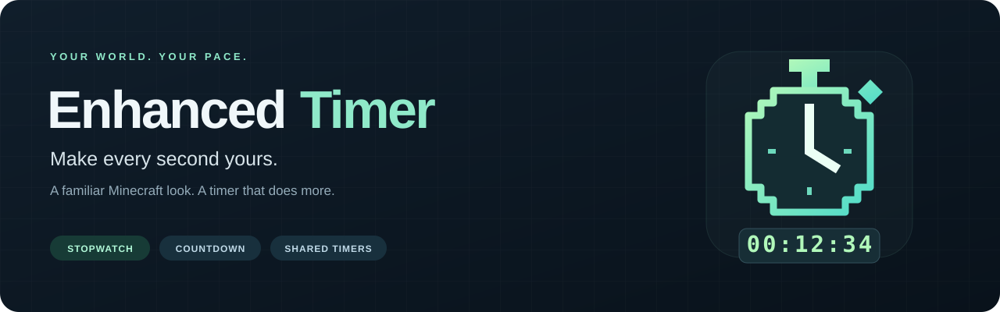
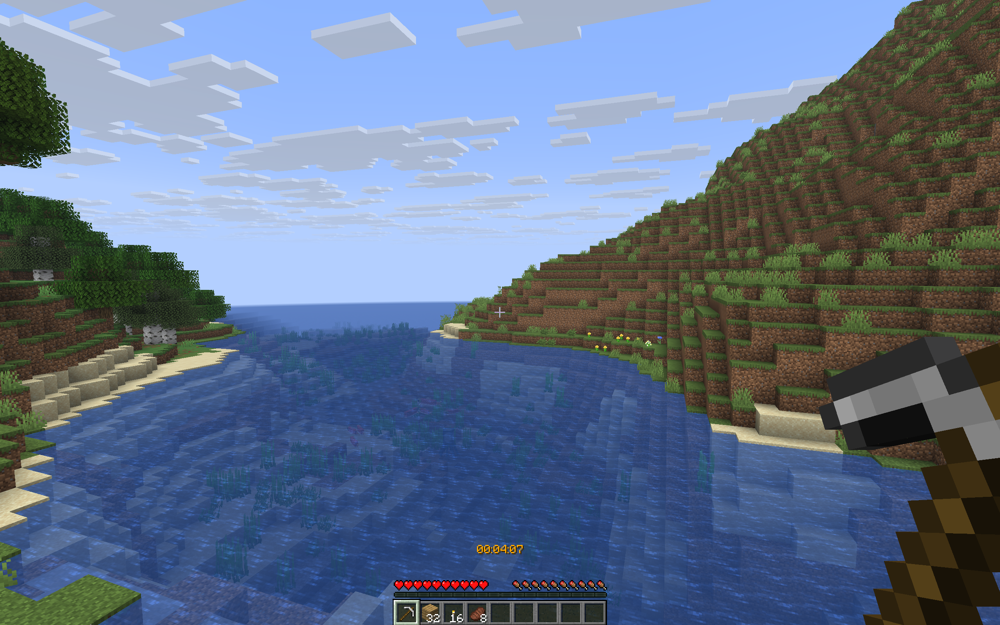
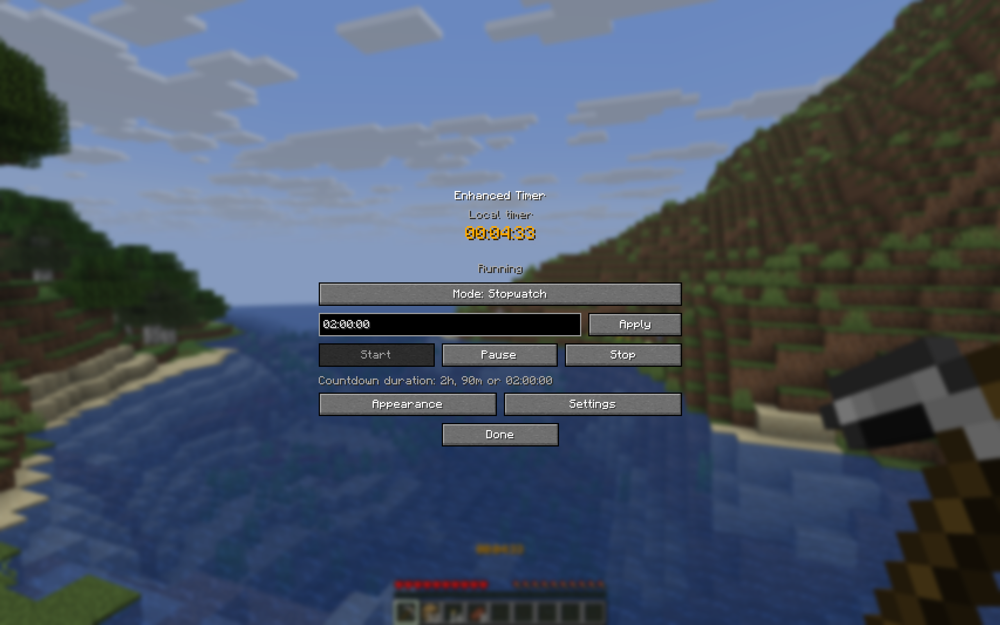
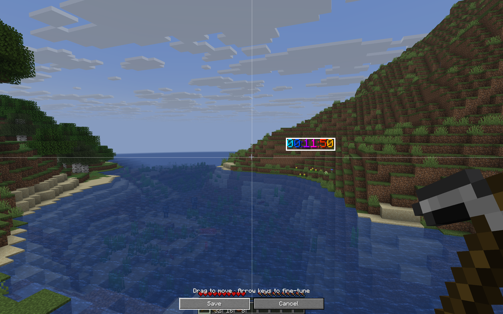
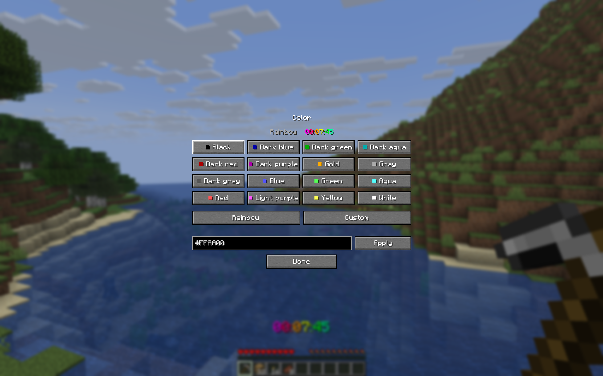
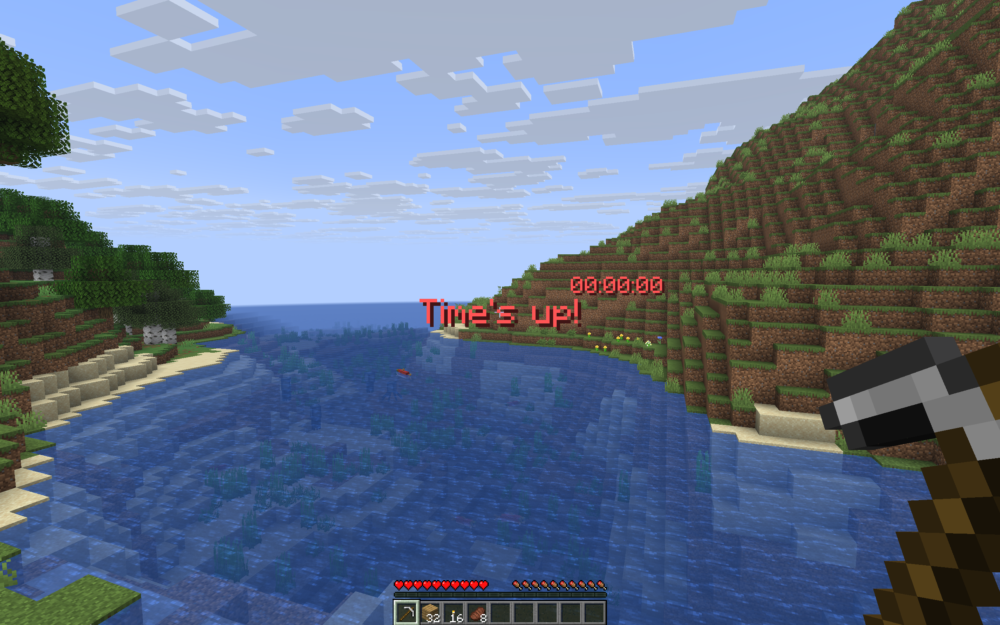

**A better timer for your next Minecraft adventure.**

Count up. Count down. Find your perfect spot on screen.

[Get started](#get-started) · [Make it yours](#customize) · [Play together](#multiplayer) · [Deutsch](README.de.md) · [Technical guide](docs/TECHNICAL.md)

[**Download 1.0.0**](https://github.com/playmonkeei/EnhancedTimer/releases/latest) · The screenshots below show the actual mod running in Minecraft.

## ✨ Your timer. Your adventure.

A survival world you'll return to for months. A build that deserves its own stopwatch. A two-hour challenge with friends. **Enhanced Timer keeps time while you play**, with a familiar Minecraft look and controls a keypress away.

<table>
<tr>
<td width="50%"><strong>⏱️ Count every second</strong> A stopwatch for your sessions, builds and runs. Start, pause, stop or pick up where you left off.</td>
<td width="50%"><strong>⌛ Beat the countdown</strong> Set a limit like two hours. Get optional warnings and a big on-screen message when time runs out.</td>
</tr>
<tr>
<td><strong>🖱️ Put it anywhere</strong> Choose a preset position or drag the timer into the perfect spot. Change its size, colors and format.</td>
<td><strong>💚 Hardcore friendly</strong> Open the menu with <strong>B</strong>. No cheats needed for your local timer, even in Hardcore.</td>
</tr>
<tr>
<td><strong>💾 Come back to your world</strong> Your time is saved per world or server. A running timer returns paused after a restart, ready when you are.</td>
<td><strong>🌍 Feel at home</strong> English, German, French and Spanish. Follows your game language, with a separate language option.</td>
</tr>
</table>

## 🚀 Ready in a minute

1. **Install your Minecraft mod loader** and put the matching Enhanced Timer JAR in your `mods` folder.
2. **Join a world or server.** Press **B** to open Enhanced Timer.
3. **Choose stopwatch or countdown, then press Start.** That's it. Enjoy your game.

On Fabric and Quilt, you can also open the settings through **Mod Menu → Enhanced Timer → Configure**. Mod Menu is optional; its own dependencies are still needed if you install it.

<strong>📦 Which file do I need?</strong>

The same mod file works with **Fabric, Quilt, Forge and NeoForge**. Pick your Minecraft version:

| You play… | Install this file |
| :--- | :--- |
| Minecraft **26.1 / 26.1.1 / 26.1.2** | `enhancedtimer-26.1-1.0.0.jar` |
| Minecraft **26.2** | `enhancedtimer-26.2-1.0.0.jar` |
| Minecraft **26.3** | `enhancedtimer-26.3-1.0.0.jar` |

**Players:** put one matching mod JAR in `mods/`. Enhanced Timer itself does not require Fabric API or QSL. Minecraft 26.x uses Java 25; use a compatible launcher/runtime.

**Server owners:** the mod JAR can also run on a matching modded server. For **Spigot, Paper, Purpur or Folia**, use `enhancedtimer-server-1.0.0.jar` in `plugins/`. Install one Enhanced Timer implementation per server.

[Download the matching JAR from Releases](https://github.com/playmonkeei/EnhancedTimer/releases/latest). The ZIP bundles every variant; install only the JAR you need.

## 🎨 Your HUD. Your style.

The default is deliberately simple: **gold Minecraft text above the hotbar**. When you want more, it's all there.

| Position | Color | Display |
| :--- | :--- | :--- |
| Nine preset anchors | All 16 Minecraft colors | Classic clock or compact units |
| Drag-and-drop editor | Animated rainbow | Days or milliseconds |
| Size and text shadow | Your own hex color | Hide empty time units |
| Optional background | Separate state colors | Custom styles and gradients |

<table>
<tr>
<td width="50%"> <strong>A place for every setup.</strong> Move it around other HUD mods. Save your layout or cancel to return to the previous position.</td>
<td width="50%"> <strong>A little more you.</strong> Go classic, pick a color, or let the rainbow do its thing.</td>
</tr>
</table>

Save your favorite looks as designs, and keep different settings for different worlds and servers.

## 🤝 Better together

Your **local timer works on ordinary servers**, so you can time a build or run without asking the server owner to install anything.

Add Enhanced Timer to the server when you want everyone on the same clock:

| 🧍 Personal | 🌐 Server | 👥 Team |
| :--- | :--- | :--- |
| Your own private server timer | One shared timer for the server | One shared timer for your group |
| You control your time | Controlled by administrators | Controlled by its owner or an administrator |

Players with the mod get the HUD and configuration screens. Players without it can follow shared time through the server's bossbar or optional actionbar. The Bukkit plugin also provides an in-game inventory menu.

## 🏁 For runs, builds and challenges

Choose what helps your game:

- **Start on movement** when you're ready to go.
- **Pause on death** if your challenge calls for it.
- **Capture splits**, including optional Nether, End and dragon milestones.
- **Stop on the dragon advancement** to finish your run.
- **Set a countdown** with warning sounds and a clear finish message.

These are optional helpers. You decide the rules of your challenge. On a server, administrators can enable additional rules such as spectator mode on death or expiry.

## ⌨️ Buttons first. Commands too.

| You want to… | Do this |
| :--- | :--- |
| Open the timer | Press **B** or type `/et` |
| Start, pause or stop | Use the buttons in the timer menu |
| Set a two-hour limit | Select Countdown, enter `2h`, apply and start |
| Move the HUD | Open Appearance → Move HUD |
| Change the language | Open Settings → Language |
| Change a key | Minecraft Options → Controls → Enhanced Timer |

Prefer typing? Try `/et timer`, `/et countdown 2h`, `/et pause` or `/et start`. Your local commands work without cheats. Shared server timers respect server permissions.

## 💬 A few useful answers

<strong>Does this work in Hardcore with cheats disabled?</strong>

Yes. The key and local timer menu work without cheats. Local `/et` commands run in your client and do not grant you permission to control a server timer.

<strong>What happens when I close Minecraft?</strong>

Your timer is saved. A running timer is restored paused on your next visit, so time spent offline is not added. In singleplayer, the local timer also follows the game's pause by default. Multiplayer keeps running when you open a menu.

<strong>What if my game language isn't supported?</strong>

Enhanced Timer uses English as its fallback. You can also choose English, German, French or Spanish directly in the mod's settings without changing Minecraft's language.

<strong>Can I use it for speedruns?</strong>

Yes, for timing your runs and recording splits. Dragon stopping follows the player's dragon advancement. There is no dedicated RTA/IGT comparison or leaderboard integration; check your category's requirements if you submit competitive runs.

<strong>Which Minecraft editions and versions are supported?</strong>

Minecraft Java 26.1, 26.1.1, 26.1.2, 26.2 and 26.3. Bedrock, proxy installation, future versions and every possible modpack are outside the current compatibility claim. Concrete test coverage and its limits are documented in the technical guide.

---

**Your next adventure starts at `00:00:00`.**

Made by **playmonkeei** · [Deutsch](README.de.md) · [Technical guide](docs/TECHNICAL.md) · [Test coverage](docs/TESTING.md) · [MIT license](LICENSE)

Enhanced Timer is an independent Minecraft project. Not an official Minecraft product. Not approved by or associated with Mojang or Microsoft.

